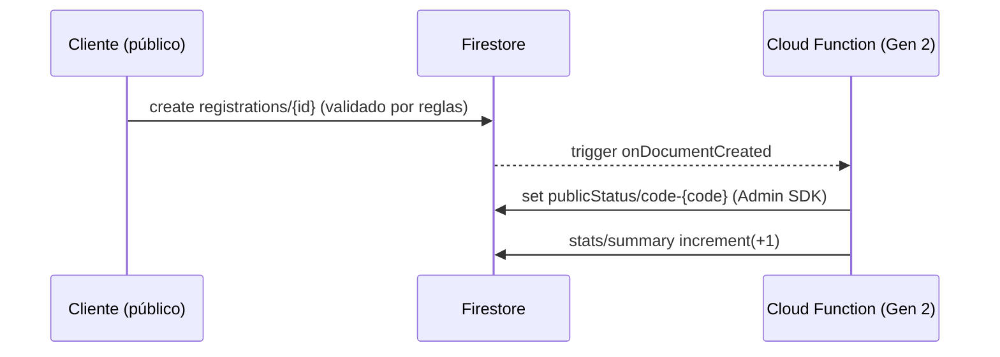

# Plan: Cloud Function `onRegistrationCreate` (publicStatus + stats)

## Objetivo
Que el cliente público **solo pueda crear `registrations`**. La proyección pública (`publicStatus/{code-RAF-xxxxx}`) y los contadores (`stats/summary`) los escribe únicamente el backend (Admin SDK), y las reglas de Firestore cierran por completo `create` público en `publicStatus` y `update` público en `stats`.

## Estado actual (a eliminar)
| Escritura pública hoy | Dónde | Riesgo |
| --- | --- | --- |
| `publicStatus` create (estado `pending`) | `syncPublicRunnerStatus` en `submitRunnerRegistration` | Cualquiera puede ocupar claves `code-*` con datos falsos |
| `stats/summary` increment +1 | `applyStatsDelta` en `submitRunnerRegistration` | Cualquiera puede inflar contadores |

## Arquitectura

Los cambios que hace el admin (confirmar, rechazar, dorsal, check-in, borrar) siguen desde el panel con `isAdmin()`; opcionalmente se pasan luego a triggers `onDocumentUpdated` / `onDocumentDeleted` para que el panel no escriba nada derivado.

## Cambios por archivo

### 1. `functions/` (nuevo)
- `functions/package.json`: Node 22, `firebase-admin`, `firebase-functions` (v2).
- `functions/index.js`:
  - `exports.onRegistrationCreate = onDocumentCreated({ document: 'registrations/{id}', region: 'southamerica-east1', retry: false, maxInstances: 5 }, handler)`
  - Handler:
    1. Lee `event.data.data()`; si falta `code` o no cumple `^RAF-\d{5}$`, hace `logger.error` y termina.
    2. Construye el payload público con la **misma** lógica de `buildPublicStatusPayload` (code, initials, distance, status, assignedBib, shirtSize, checkedIn, updatedAt). Mover esa función a `functions/lib/publicStatus.js`.
    3. **Idempotencia:** `db.runTransaction` que hace `create()` del doc `publicStatus/code-{code}` solo si no existe, y el incremento de `stats/summary` en la misma transacción. Así un reintento del trigger no duplica contadores.
    4. **Colisión de código:** si publicStatus/code-{code} ya existe con otro 
egistrationId, la función no lo pisa: registra logger.error y marca 
egistrations/{id}.codeConflict = true para revisión del admin.
  - Opcional: `onDocumentUpdated` (cambios de `status`/`assignedBib`/`checkedIn`/`shirtSize` → actualizar `publicStatus` y aplicar delta en stats) y `onDocumentDeleted` (borrar `publicStatus` y restar en stats).
- `firebase.json`: agregar bloque `functions` (source `functions`) y mantener `firestore.rules`.

### 2. `firestore.rules`
- `publicStatus`: `allow get: if true; allow list: if false; allow create, update, delete: if false;` (el Admin SDK ignora las reglas). Si se mantiene el sync desde el panel durante la transición: `allow write: if isAdmin();`.
- `stats/summary`: `allow read: if isAdmin(); allow write: if isAdmin();` y eliminar `isPublicStatsIncrement` y `isValidPublicStatusCreate`.
- `registrations`: mantener `create` validado; agregar `request.resource.data.keys().hasOnly([...])` con la lista permitida de campos para impedir campos extra, y no permitir `checkedIn` ni `checkedInAt` en el create.

### 3. `src/firebase/config.js`
- `submitRunnerRegistration`: quitar `syncPublicRunnerStatus` y `applyStatsDelta` del flujo público. Solo `addDoc` y guardar el stub local `{id, code, status}`.
- Código: se sigue generando en el cliente (el corredor lo ve de inmediato), pero con más entropía (RAF- + 8 caracteres alfanuméricos con crypto.getRandomValues) para que la colisión sea despreciable. Las reglas aceptan el patrón nuevo y el legado RAF-\d{5}.
- Mantener `syncAllPublicRunnerStatuses` como herramienta de reconstrucción manual (admin).

### 4. Secretos y credenciales
- La función usa credenciales del servicio por defecto (Application Default Credentials); **no hay claves en el frontend ni en el repo**.
- Cualquier secreto adicional (ej. webhook) se guarda con `firebase functions:secrets:set` (Secret Manager) y se declara en `defineSecret`.
- Mantener `.env` fuera de git y limitar la API key de Firebase por dominio (restricción HTTP referrer en Google Cloud Console).
- Activar **App Check** (reCAPTCHA Enterprise) en `registrations` para frenar spam de altas.

## Costos (Blaze)
- Una invocación + 2-3 escrituras por inscripción. A 1.000 inscripciones: ~1.000 invocaciones (dentro de las 2 M gratis/mes) y ~3.000 escrituras (centavos).
- `maxInstances: 5` y `retry: false` evitan tormentas de reintentos y costos descontrolados. Presupuesto y alerta en Google Cloud Billing (por ejemplo USD 5).

## Despliegue y migración (orden)
1. Crear `functions/`, desplegar **solo** la función: `firebase deploy --only functions`.
2. Probar con el emulador (`firebase emulators:start --only functions,firestore`) creando una inscripción de prueba.
3. Desplegar el frontend sin sync público (paso 3) y verificar que `publicStatus` se crea por la función.
4. Desplegar reglas cerradas: `firebase deploy --only firestore:rules`.
5. Ejecutar "Sincronizar" una vez en el panel para reconstruir `publicStatus` y `stats/summary` de inscriptos existentes.
6. Monitorear Logs de Functions durante 48 h.

## Riesgos y mitigaciones
| Riesgo | Mitigación |
| --- | --- |
| Latencia entre el alta y la aparición en `publicStatus` (1-3 s) | El comprobante de inscripción muestra el código localmente; la consulta pública puede mostrar "pendiente de procesamiento" |
| Trigger duplicado | Transacción idempotente con `create()` |
| Función caída | Botón "Sincronizar" reconstruye todo desde `registrations` |
| Abuso de altas masivas | App Check + `maxInstances` + alertas de facturación |

## Criterios de aceptación
- Un cliente sin autenticar **no puede** escribir en `publicStatus` ni `stats` (verificado con el emulador de reglas).
- Una inscripción nueva genera `publicStatus/code-{code}` y suma +1 a `stats/summary` exactamente una vez.
- El build del frontend no contiene referencias a escrituras de `publicStatus`/`stats` en el flujo público.
